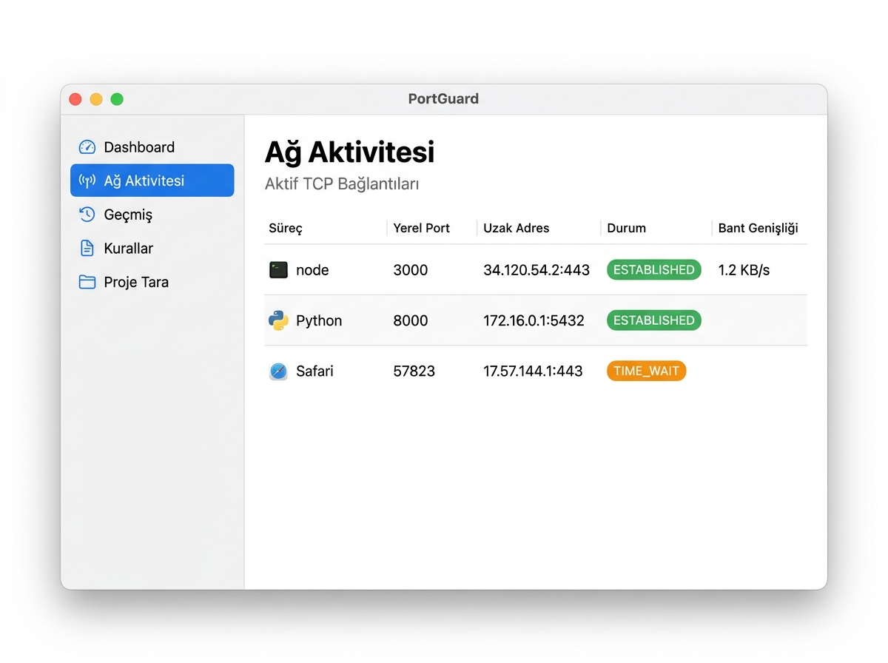
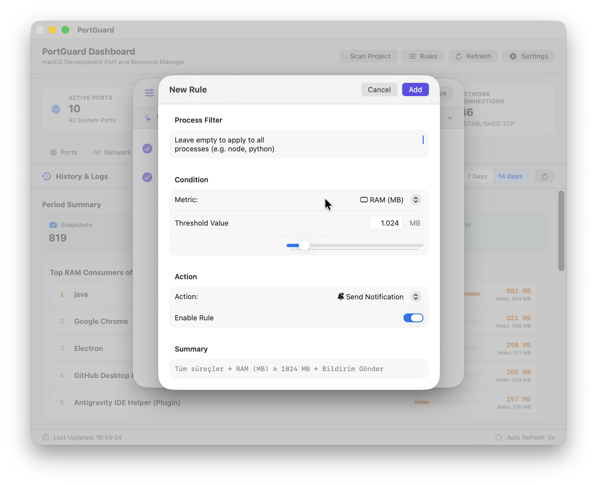
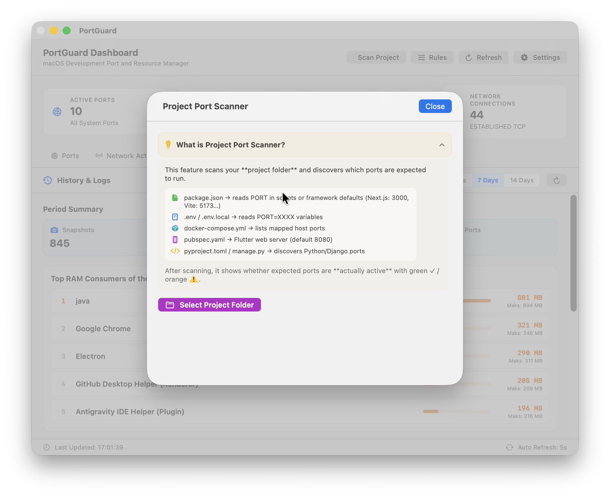
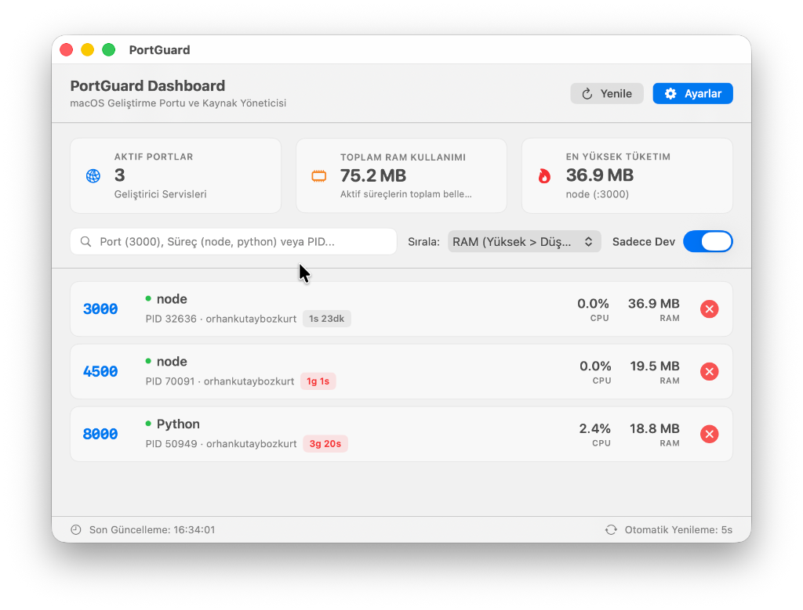
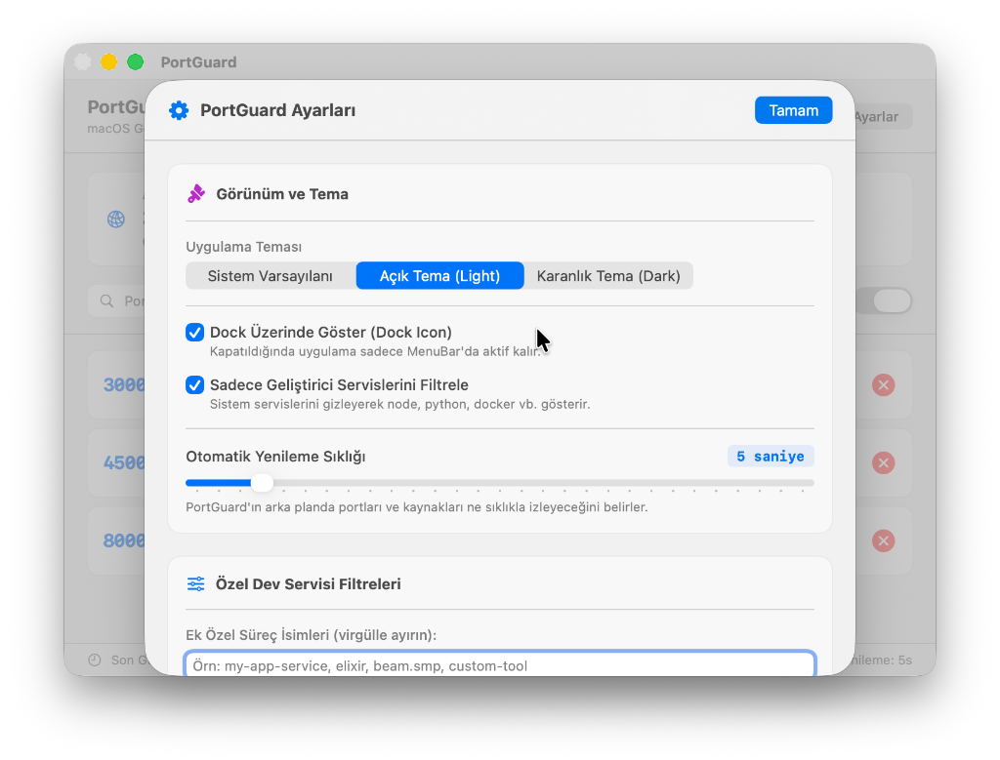

# PortGuard

🇬🇧 **English** · 🇹🇷 [Türkçe](README.tr.md)

> **A macOS menu bar port & resource monitor** — an ultra-lightweight app that watches your developer ports (Node, Python, Docker, Go, Flutter and more), shows per-process RAM/CPU usage, and lets you stop a process with one click.


---

## Problem and Solution

### The problem
Developers run many dev servers throughout the day: `npm run dev`, `flutter run`, `vite`, `docker`, `python uvicorn`, and so on. When a terminal tab is closed, these servers are often left running in the background, and the forgotten ports:
- Consume a lot of **RAM (1–4 GB+)** and **CPU (15–30%+)**.
- **Drain your Mac's battery** and make it run hot.
- Cause `EADDRINUSE: address already in use` errors the next time you start a project.

### The solution: PortGuard
PortGuard lives in the macOS menu bar and in a full dashboard window. It scans developer ports in the background, shows which service owns which port and how much RAM/CPU it uses, and lets you safely terminate (`kill -15`) the right process with a single click.

---

## Key Features

- **Instant port and PID detection:** Lists all listening TCP ports within milliseconds via `/usr/sbin/lsof` and `/bin/ps`.
- **Port conflict resolver:** One-click "Stop and Restart" for a busy port. The command and working directory are shown in a confirmation dialog, arguments are never re-interpreted by a shell, and the process is re-verified right before it is stopped.
- **Quick search palette (`⌥⌘P`):** A Spotlight-style palette available from anywhere. Search by port or process name, stop with a second confirmation, or restart with `⌘↩`.
- **Process details:** Working directory, full command line, PID/PPID, and start time.
- **Low resource usage:** Refreshes less often and skips network scans while the window and popover are not visible.
- **Live RAM & CPU monitoring:** Real-time per-process memory (MB/GB) and CPU (%) usage.
- **Network activity:** Tracks active ESTABLISHED TCP connections per process with live inbound/outbound bandwidth (KB/s, MB/s).
- **History & trends:** Archives daily RAM/CPU peaks and active port counts in local JSON files so you can follow trends over time.
- **Rule engine:** Define automatic alert or kill rules for processes that exceed RAM or CPU thresholds.
- **Project scanner:** Scans a project folder's config files (`package.json`, `.env`, `docker-compose.yml`, …) to find the ports it uses and detect possible conflicts.
- **Single and batch kill:** Safely terminate conflicting or resource-hungry services (`kill -15`), or select several ports and stop them all at once.
- **Instant language switching:** Switch between Turkish and English from Settings without restarting the app.
- **Update checker:** Checks GitHub for new releases from Settings and takes you straight to the download page.
- **Developer filter & whitelist:** Hides system services and focuses on development tools (`node`, `python`, `docker`, `go`, `vite`, …).

---

## Screenshots

| Network Activity | History & Trends |
| :---: | :---: |
|  |  |
| *Active TCP connections, TCP state descriptions, and live bandwidth.* | *Daily RAM peaks, average CPU, and port count trends.* |

| Rule Engine | Project Scanner |
| :---: | :---: |
|  |  |
| *Threshold-based RAM/CPU violation detection with automatic notifications or termination.* | *Port analysis from project files with live conflict warnings.* |

| Developer Services (Dev Mode) | Settings |
| :---: | :---: |
|  |  |
| *Shows only developer tools such as Node, Python, and Docker.* | *Persistent settings, RAM limits, update checks, and theme management.* |

---

## Installation and Usage

There are three ways to install PortGuard.

### Option 1: Prebuilt installer (.dmg, recommended)

1. Download the `.dmg` from the [GitHub Releases](https://github.com/okutaybozkurt/PortGuard/releases) page (or use `dist/PortGuard-Installer.dmg`).
2. Double-click the downloaded `.dmg`.
3. Drag `PortGuard.app` into the **Applications** folder.
4. Launch the app. PortGuard appears in your menu bar and Dock.

> **⚠️ Note (unidentified developer warning):**
> PortGuard is an independent open-source project, so on first launch macOS Gatekeeper may say *"PortGuard can't be opened because the developer cannot be verified."*
> **Fix:** Right-click the PortGuard icon in Applications and choose **Open**, or go to `System Settings → Privacy & Security` and click **"Open Anyway"**.

---

### Option 2: Build from source

1. **Clone the repository:**
   ```bash
   git clone https://github.com/okutaybozkurt/PortGuard.git
   cd PortGuard
   ```

2. **Run the tests:**
   ```bash
   swift test
   ```

3. **Build and package the app:**
   ```bash
   chmod +x scripts/build_app.sh
   ./scripts/build_app.sh
   ```
   *The `.app` bundle and the `.dmg` installer are created in the `dist/` folder.*

4. **Run the app:**
   ```bash
   open dist/PortGuard.app
   ```

---

### Option 3: Install or update from the terminal

To install or update without opening a browser:

1. **Quit the running version:**
   ```bash
   killall PortGuard 2>/dev/null
   ```

2. **Download the latest release:**
   ```bash
   curl -L -o ~/Downloads/PortGuard.zip https://github.com/okutaybozkurt/PortGuard/releases/latest/download/PortGuard-macOS.zip
   ```

3. **Extract the archive:**
   ```bash
   unzip -o ~/Downloads/PortGuard.zip -d ~/Downloads
   ```

4. **Install into Applications:**
   ```bash
   rm -rf /Applications/PortGuard.app
   mv ~/Downloads/PortGuard.app /Applications/PortGuard.app
   ```

5. **Clear the quarantine flag and launch:**
   ```bash
   xattr -dr com.apple.quarantine /Applications/PortGuard.app
   open /Applications/PortGuard.app
   ```

Or run everything as a single command:

```bash
killall PortGuard 2>/dev/null; curl -L -o ~/Downloads/PortGuard.zip https://github.com/okutaybozkurt/PortGuard/releases/latest/download/PortGuard-macOS.zip && unzip -o ~/Downloads/PortGuard.zip -d ~/Downloads && rm -rf /Applications/PortGuard.app && mv ~/Downloads/PortGuard.app /Applications/PortGuard.app && xattr -dr com.apple.quarantine /Applications/PortGuard.app && open /Applications/PortGuard.app
```

The `releases/latest/download/...` URL always points to the newest release, so the command keeps working when a new version is published.

---

## Architecture and Design Principles

PortGuard is built with **SOLID principles**, **clean code standards**, and common **design patterns**:

- **Single Responsibility Principle (SRP):** Command execution (`ShellCommandExecutor`), output parsing (`LsofOutputParser`), and filtering (`DevProcessFilter`) are separate classes.
- **Open/Closed Principle (OCP) & Strategy pattern:** Filtering rules are pluggable through `ProcessFilterStrategyProtocol`.
- **Dependency Inversion (DIP) & Dependency Injection (DI):** The `PortMonitorEngine` view model depends on protocols, so it can be unit tested in full isolation (`MockCommandExecutor`).
- **Facade pattern:** `ProcessManager` coordinates all background operations behind one simple API.

---

## Security and Privacy

**Local-only, minimal network access, zero telemetry:**
- Port and RAM/CPU monitoring runs entirely on your machine using built-in macOS commands (`/usr/sbin/lsof`, `/bin/ps`). No data leaves your computer.
- The **only** network request PortGuard makes is a call to GitHub's public Releases API (`api.github.com/repos/okutaybozkurt/PortGuard/releases/latest`) to look up the latest version. It never runs automatically in the background; it is triggered only when you click "Check for Updates" in Settings.
- There is no analytics, crash reporting, or usage tracking.
- The repository contains no API keys, secrets, or credentials.

---

## License

This project is licensed under the **MIT License**. See [LICENSE](LICENSE) for details.

*Developer:* [Orhan Kutay Bozkurt](https://github.com/okutaybozkurt)
